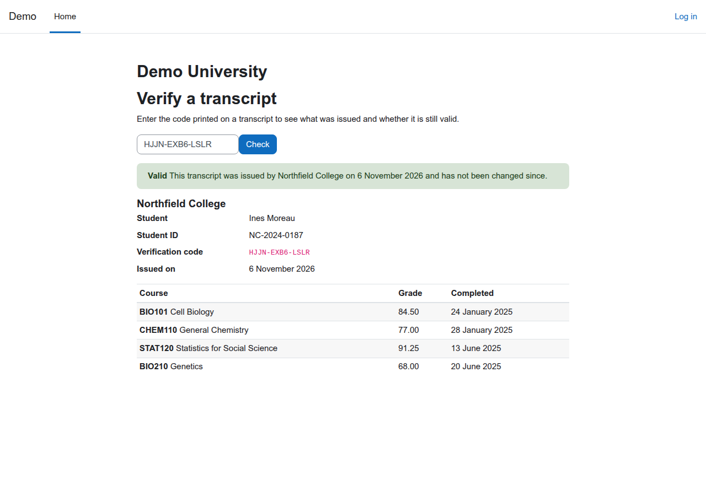
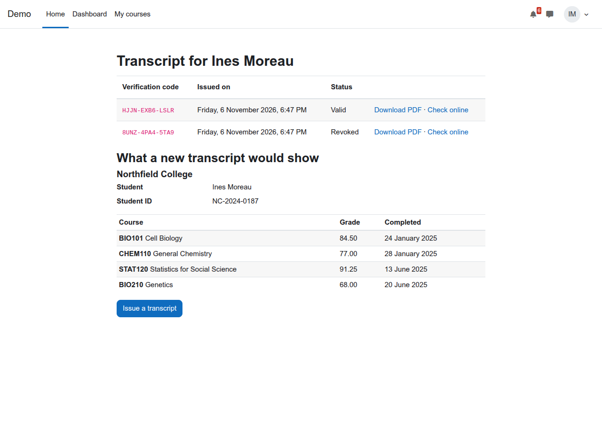
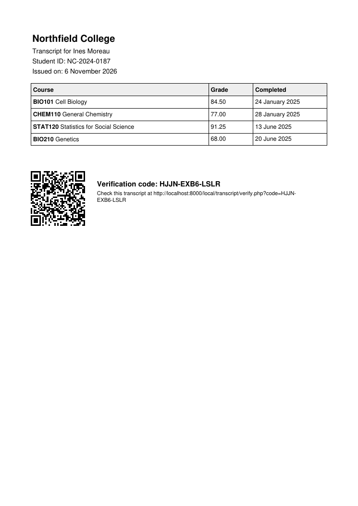

# Verifiable transcripts for Moodle (local_transcript)

[](https://github.com/devlms/moodle-local_transcript/actions/workflows/ci.yml)
[](https://devlms.github.io/moodle-local_transcript/)
[](https://devlms.github.io/moodle-local_transcript/php-coverage/)
[](https://moodledev.io/general/releases)
[](https://www.php.net/supported-versions.php)
[](LICENSE)
[](version.php)

A student issues a transcript of the courses they completed, with final grades and completion dates. It gets a code like `K7QM-4XRT-9HCP` and a PDF with a QR code. An employer or another school types the code (or scans it) on a public page, without an account, and sees exactly what was issued and whether it is still valid.

Moodle core has badges and course completion, and certificate plugins cover one course at a time, but core has no transcript of a student's whole record that a third party can check. Schools end up exporting grades to a spreadsheet and emailing a PDF that anyone could edit. This plugin keeps the issued record on your Moodle and lets the reader check it there.



## What it does

| Part | Status |
| --- | --- |
| Students issue their own transcript from their profile; managers issue for any student | Done |
| Completed courses with final grade (as the course gradebook shows it) and completion date. Option to include graded courses that are not completed yet, or to leave grades off | Done |
| Each transcript is a frozen copy. Grades that change later do not change a transcript that was already issued | Done |
| Public verify page, no login: Valid, Revoked, Altered or Not found | Done |
| Signed with HMAC-SHA256. A grade or name edited in the stored record shows as Altered | Done |
| PDF with the code and a QR code to the verify page | Done |
| Revoke with a reason. The code then verifies as Revoked, with the date; the reason stays with staff | Done |
| Admin list of every issued transcript, searchable by code or name | Done |
| Log events for issue and revoke. Privacy API export and delete | Done |
| Institution logo and a signature line on the PDF | Planned |
| Programme or category grouping, credits and GPA | Planned |



## How verification works

When a transcript is issued, the plugin stores the student's name, ID number, courses, grades and dates as they are at that moment, and signs the code, student, time and data with HMAC-SHA256. The secret is created on install and never leaves the site. It is stored in the plugin settings; for a stronger setup put it in `config.php` as `$CFG->local_transcript_secret` (at least 32 characters), so someone with only database access cannot re-sign a record. Signing protects the stored data against edits, not against someone who controls the whole server. The verify page recomputes the signature: if someone changes a grade in the stored copy, the page says the record was altered instead of showing it. Codes use 12 characters from a 32 letter alphabet without 0, O, 1 and I, so they are easy to read out, and there are far too many to guess (32 to the power of 12).

Revoking keeps the record, so anyone who checks a revoked transcript finds out it was revoked; the page then shows the status only, not the contents. Deleting a student's account revokes their transcripts. Deleting a student under the privacy API deletes their transcripts, and their codes stop verifying. Grades hidden in the gradebook, or in courses that hide grades from students, never go on a transcript.



## Install

Needs Moodle 4.5 to 5.3.

1. Download the zip from [Releases](https://github.com/devlms/moodle-local_transcript/releases) and install it under Site administration, Plugins, Install plugins. Or clone it:

   ```bash
   # Moodle 4.5 and 5.0
   git clone https://github.com/devlms/moodle-local_transcript.git local/transcript
   # Moodle 5.1 and later
   git clone https://github.com/devlms/moodle-local_transcript.git public/local/transcript
   ```

2. Visit Site administration, Notifications to finish the install.
3. Set the institution name under Site administration, Plugins, Local plugins, Verifiable transcripts. Students find "Transcripts" on their profile page. The verify page is `/local/transcript/verify.php`.

## Permissions

| Capability | Default roles | Allows |
| --- | --- | --- |
| `local/transcript:issueown` | Authenticated user | Issue and download your own transcript |
| `local/transcript:manage` | Manager | Issue for any student, see every transcript, revoke |

Remove `local/transcript:issueown` from the Authenticated user role if only the registry should issue transcripts.

## Privacy

A student's data request covers every transcript issued for them, with its contents. Staff who issued or revoked a transcript get the code and dates. Deleting a staff member's data removes only their id from the record; the transcript still verifies, because the signature does not cover who issued it.

## Tests

PHPUnit covers which courses go on a transcript (completed, graded, hidden, other students), plain-text names, issuing, the frozen copy, tampering with the stored data, a changed secret, revoking, unknown codes and the privacy provider. The PDF test only checks that a PDF is produced; its layout is checked by eye. Behat walks a student through issuing, a logged out visitor through verifying, and a manager through revoking, in a real browser with Moodle's accessibility checks on. CI runs on Moodle 4.5 to 5.3 with PostgreSQL and MariaDB: [reports](https://devlms.github.io/moodle-local_transcript/).

## Who made it

[DevLMS](https://devlms.com) builds custom Moodle plugins. Need your logo and signatures on it, credits and GPA, or a link to your student records system? [Get a quote](https://devlms.com/#quote).

## License

GNU GPL v3 or later.
